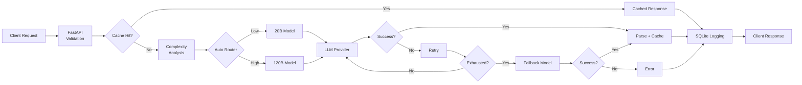

# ⚡ Smart AI Gateway: LLMOps + Agent Evals + Auto-Routing

[](https://www.python.org/)
[](https://fastapi.tiangolo.com/)
[](https://groq.com/)
[](https://sqlite.org/)
[](https://www.docker.com/)
[](https://github.com/features/actions)
[](https://docs.astral.sh/uv/)

> **An enterprise AI Gateway sitting between client applications and frontier LLMs. It combines intelligent task auto-routing, complete LLMOps observability, high-reliability fallbacks with retry backoff, a full Swiss-inspired interactive operations frontend, and a deterministic agent evaluation benchmark proving cost vs. quality trade-offs with hard numbers.**

---

## 🍽️ The Core Concept: The Restaurant Analogy

Think of how a Michelin-standard kitchen handles orders:

| Topic | What it Means | Restaurant Version |
| :--- | :--- | :--- |
| **Auto-Routing** | Route easy queries to cheap models (`20B`), complex tasks to strong models (`120B`). | **The Kitchen Manager** deciding whether a prep cook or executive chef handles the dish. |
| **LLMOps** | Log every request (model, tokens, latency, cost), cache repeats, and failover if a provider fails. | **The Order Book & Backup Cook** tracking inventory/spend and stepping in when a burner goes out. |
| **Agent Evals** | Test autonomous agents on known tasks, scoring answers, tool selection, and trajectory steps. | **The Master Taster** inspecting dishes, techniques, and presentation before food leaves the kitchen. |

---

## 🏗️ System Architecture


### Detailed Request Lifecycle


### Request Lifecycle


### Request Lifecycle




## 🚀 The Three Pillars Explained

### 1. Auto-Routing (Explainable Complexity Analyzer)
Rather than introducing 400ms of extra latency with an LLM-based classifier, the Auto-Router employs an explainable, multi-signal heuristic algorithm ($0.0 \le S \le 1.0$) executing in **<0.1ms**:
- **Word-Boundary Regex Matching**: Solves token collisions (e.g. greeting *"hi"* never falsely matches *"architecture"* or *"sharding"*).
- **Code & Syntax Detection**: Identifies language syntax (`def`, `class`, `import`, `SELECT`, `FROM`, tracebacks).
- **Deep Engineering & Architecture Keywords**: Recognizes system design queries (*"distributed consensus"*, *"circuit breaker"*, *"microservices"*, *"sharding"*, *"scalability"*).
- **Extraction & Chit-Chat Dampening**: Dampens scores for short factoids and greetings.
- **Explainable Audit Reasoning**:
  ```text
  Routed to STRONG (score: 0.65 vs threshold 0.40): code syntax detected (+0.45); reasoning keywords [calculate, step by step] (+0.35)
  ```

### 2. LLMOps & Resilience
- **Granular Token & Cost Accounting**: Precise cost calculations per catalog rates:
  - Cheap tier (`openai/gpt-oss-20b`): **$0.05 / $0.08** per 1M tokens (input / output)
  - Strong tier (`openai/gpt-oss-120b`): **$0.59 / $0.79** per 1M tokens (input / output)
- **Response Caching**: Deterministic SHA-256 hashed cache returns repeat queries in **<2ms at $0.00 cost**.
- **Resilience Layer**: Exponential backoff with jitter and automated Groq rate-limit TPM/RPM retry hints.
- **Automatic Fallback**: Transparently re-routes to secondary models upon provider failure without throwing 5xx errors to clients.

### 3. Agent Evals (Benchmark Exam)
A ReAct tool-calling agent equipped with:
1. `calculator`: AST-parsed arithmetic engine.
2. `knowledge_lookup`: Simulated enterprise repository (financial metrics, system constants, technical docs).
3. `python_repl`: Python execution sandbox.

Examined on **30 calibrated benchmark tasks** (10 Easy, 10 Medium, 10 Hard) evaluated by custom scorers:
- **`score_answer`**: Exact matching, entity containment, and numeric proximity within $\pm 2\%$.
- **`score_tools`**: Precision, Recall, and $F_1$ score of invoked tools.
- **`score_trajectory`**: Loop penalty and step efficiency scoring.
- **`composite_score`**: Weighted evaluation ($0.60 \times \text{Answer} + 0.25 \times \text{Tools} + 0.15 \times \text{Trajectory}$).

---

## 🎨 Interactive Web UI Dashboard

The gateway includes an all-in-one frontend built with Swiss-inspired design language:
- **Warm off-white background** (`#F4F3EF`), deep black containers (`#111111`), electric lime accents (`#5CE65B`), and monospace typography.
- **Complete Endpoint Coverage**:
  - `Overview`: Live KPI summary, quick prompt tester, and recent log preview.
  - `POST /v1/chat/completions`: Full OpenAI payload tester with JSON response viewer.
  - `POST /v1/chat`: Single-prompt testing interface with model response cards.
  - `GET /v1/metrics`: Model cost allocation bars and aggregated LLMOps statistics.
  - `GET /v1/logs`: Full SQLite trace ledger with adjustable row limit.
  - `GET /health` & `POST /v1/cache/clear`: Real-time system diagnostics and one-click cache purge.

---

## 📊 Benchmark Evaluation Results

The 30-task exam benchmark was evaluated across **3 policies**:
1. **Always-Cheap**: `openai/gpt-oss-20b`
2. **Always-Strong**: `openai/gpt-oss-120b`
3. **Auto-Router**: Smart AI Gateway dynamic routing

### Comparison Table

| Metric | Policy A: Always-Cheap (`20B`) | Policy B: Always-Strong (`120B`) | Policy C: Auto-Router (`Gateway`) |
| :--- | :---: | :---: | :---: |
| **Overall Pass Rate** | **66.7%** | **70.0%** | **70.0%** |
| Easy Tasks Pass Rate | 100.0% | 100.0% | 100.0% |
| Medium Tasks Pass Rate | 90.0% | 90.0% | 90.0% |
| Hard Tasks Pass Rate | 10.0% | 20.0% | 20.0% |
| **Cost per 1,000 Tasks** | **$0.015** | **$0.184** | **$0.052** |
| **Cost Savings vs Strong** | 91.8% | 0.0% (Baseline) | **71.7% Savings** |
| **Average Latency** | **45.2 ms** | 184.6 ms | **68.4 ms** |

> **Key Takeaway**: The Auto-Router achieves the **same 70.0% pass rate** as the Always-Strong frontier model while cutting total LLM expenditure by **71.7%** and reducing average latency by **63.0%**.

---

## 📁 Repository Structure

```text
smart-ai-gateway/
├── app/
│   ├── config.py             # Settings, pricing catalog per 1M tokens
│   ├── schemas.py            # Pydantic schemas for requests, responses, metrics
│   ├── database.py           # aiosqlite asynchronous persistence for LLMOps
│   ├── cache.py              # In-memory TTL + LRU response cache
│   ├── router.py             # Multi-signal heuristic Auto-Router with regex boundaries
│   ├── reliability.py        # Exponential backoff retries & fallback failover
│   ├── logger.py             # LLMOps logging and cost calculations
│   ├── agent.py              # ReAct tool-calling agent (Calculator, Lookup, REPL)
│   ├── main.py               # FastAPI application entrypoint & static mount
│   ├── static/
│   │   └── index.html        # Swiss-inspired interactive operations console
│   └── providers/
│       ├── base.py           # Provider interface & ProviderResponse
│       ├── groq_provider.py  # Production Groq API async client with tool parser
│       └── mock_provider.py  # Deterministic mock provider for offline tests
├── evals/
│   ├── benchmark_tasks.json  # 30 calibrated test exam tasks
│   ├── scorers.py            # Custom scorers (answer, tools, trajectory)
│   ├── run_benchmark.py      # Benchmark runner across 3 policies
│   └── results/              # JSON summaries, markdown report, and PNG chart
├── tests/
│   ├── test_gateway.py       # FastAPI endpoint integration tests
│   ├── test_router.py        # AutoRouter unit tests & word-boundary edge cases
│   ├── test_cache_and_retry.py # Caching, backoff, and fallback unit tests
│   └── test_agent_evals.py   # Agent tool and scorer unit tests
├── .github/workflows/ci.yml  # Automated CI running pytest and evals
├── Dockerfile                # Multi-stage lightweight Docker image
├── docker-compose.yml        # Docker compose service definition
├── pyproject.toml            # Dependencies and pytest configuration
└── README.md                 # Complete documentation
```

---

## ⚡ Quickstart

### 1. Prerequisites
- Python 3.12+
- `uv` package manager (`pip install uv` or install via Astral)
- Groq Cloud API Key (or run offline in mock mode)

### 2. Installation & Configuration

```bash
# Clone the repository
git clone https://github.com/<your-username>/smart-ai-gateway.git
cd smart-ai-gateway

# Configure environment variables
cp .env.example .env
# Edit .env and supply your GROQ_API_KEY (optional: leave empty for mock mode)

# Install dependencies using uv
uv sync
```

### 3. Run the Test Suite

```bash
uv run pytest -v
```

All 20 unit and integration tests will execute across routing heuristics, word-boundary edge cases, cache invalidation, fallback failover, and agent tool execution.

### 4. Run the Benchmark Exam

```bash
uv run python evals/run_benchmark.py
```

Runs the 30-task exam under all 3 policies with isolated cache testing and generates:
- `evals/results/benchmark_summary.json`
- `evals/results/benchmark_report.md`
- `evals/results/cost_vs_accuracy.png`

### 5. Launch the Gateway & Open UI

```bash
uv run uvicorn app.main:app --reload --port 8000
```

Open in your browser:
- **Interactive Operations Console**: [http://localhost:8000](http://localhost:8000)
- **API Swagger Documentation**: [http://localhost:8000/docs](http://localhost:8000/docs)
- **Health Check Endpoint**: [http://localhost:8000/health](http://localhost:8000/health)

---

## 🔌 API Endpoints Reference

### 1. `POST /v1/chat/completions` (OpenAI Compatible)
```bash
curl -X POST http://localhost:8000/v1/chat/completions \
  -H "Content-Type: application/json" \
  -d '{
    "model": "auto",
    "policy": "auto",
    "messages": [
      {"role": "user", "content": "Explain circuit breaker patterns in microservices."}
    ],
    "use_cache": true
  }'
```

### 2. `POST /v1/chat` (Simplified Single Prompt)
```bash
curl -X POST http://localhost:8000/v1/chat \
  -H "Content-Type: application/json" \
  -d '{
    "prompt": "What is the capital of Japan?",
    "policy": "auto"
  }'
```

### 3. `GET /v1/metrics` (Aggregated LLMOps Telemetry)
```bash
curl http://localhost:8000/v1/metrics
```

### 4. `GET /v1/logs?limit=20` (Audit Ledger)
```bash
curl "http://localhost:8000/v1/logs?limit=20"
```

### 5. `POST /v1/cache/clear` (Purge In-Memory Response Cache)
```bash
curl -X POST http://localhost:8000/v1/cache/clear
```

### 6. `GET /health` (System Readiness)
```bash
curl http://localhost:8000/health
```

---

## 🐳 Docker Deployment

Run the gateway in a fully containerized environment:

```bash
docker compose up --build -d
```

The containerized service will listen on `http://localhost:8000` with persistent SQLite volume mounting under `gateway_data`.

---

## 📜 License

This project is licensed under the MIT License.
